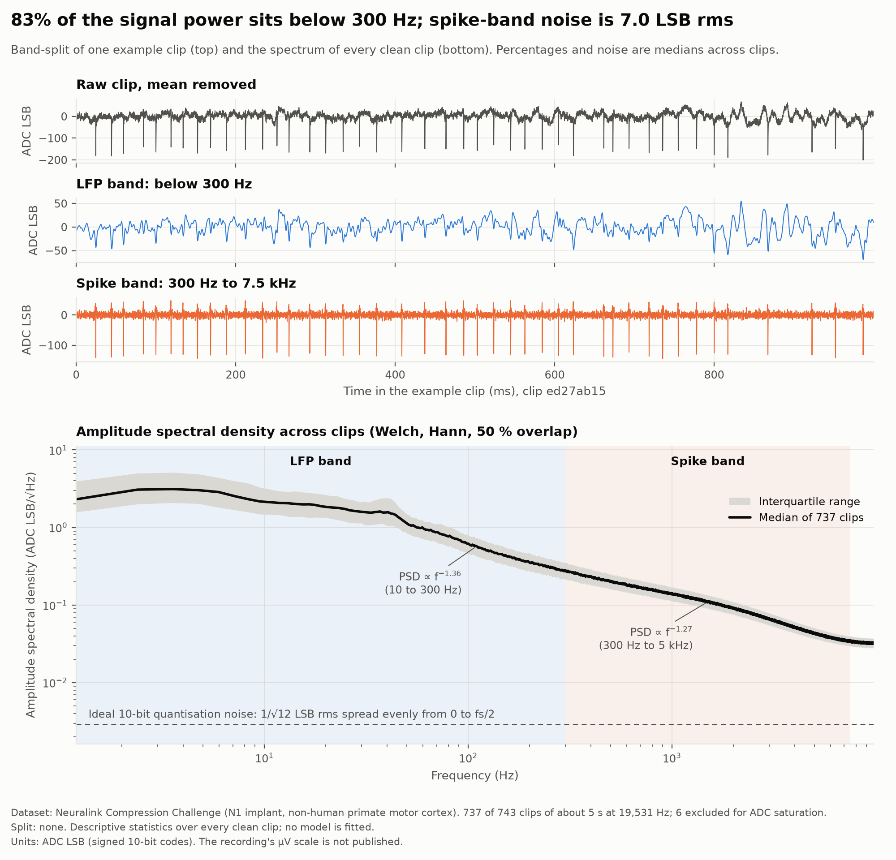
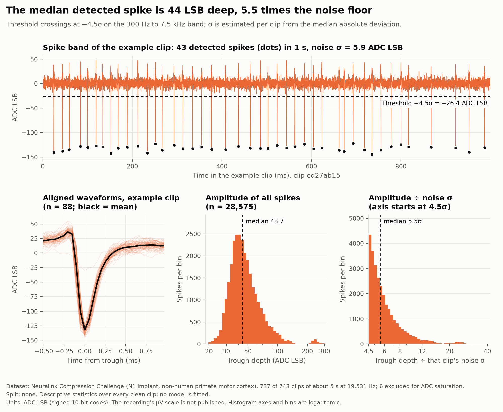
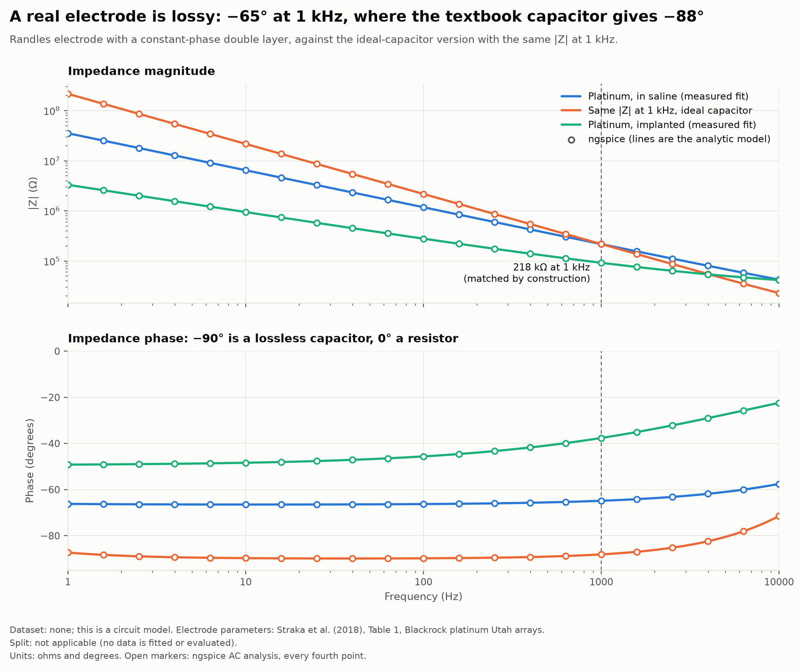
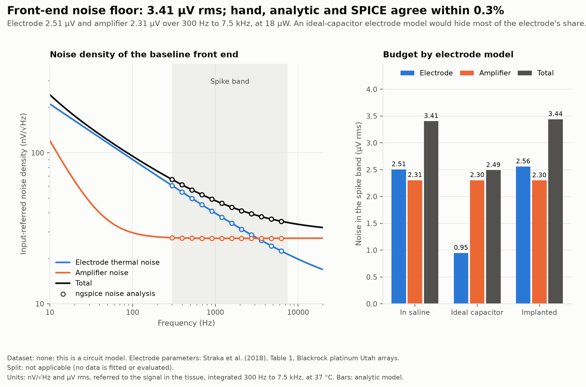
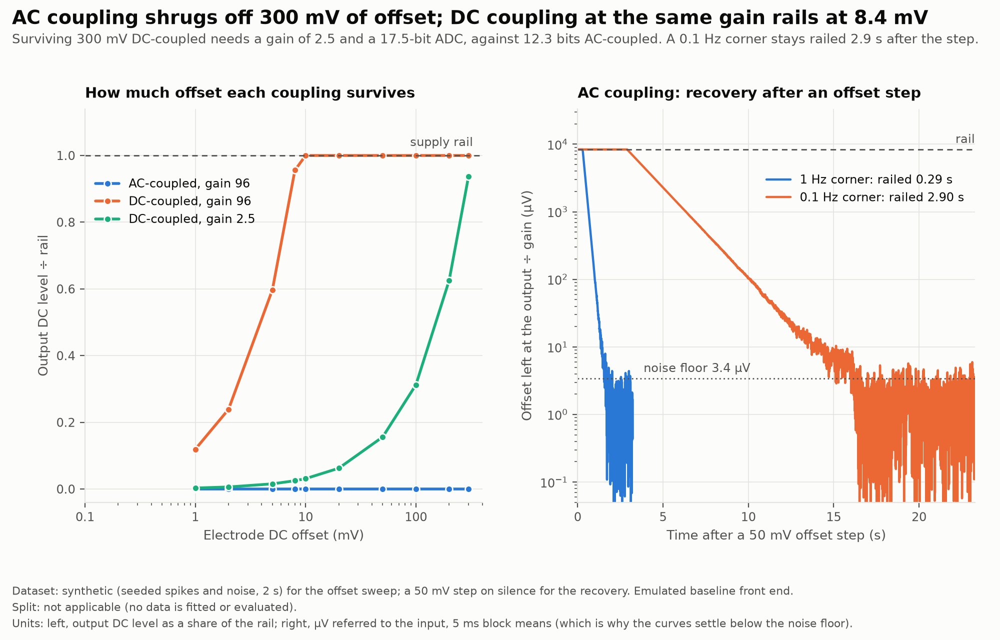
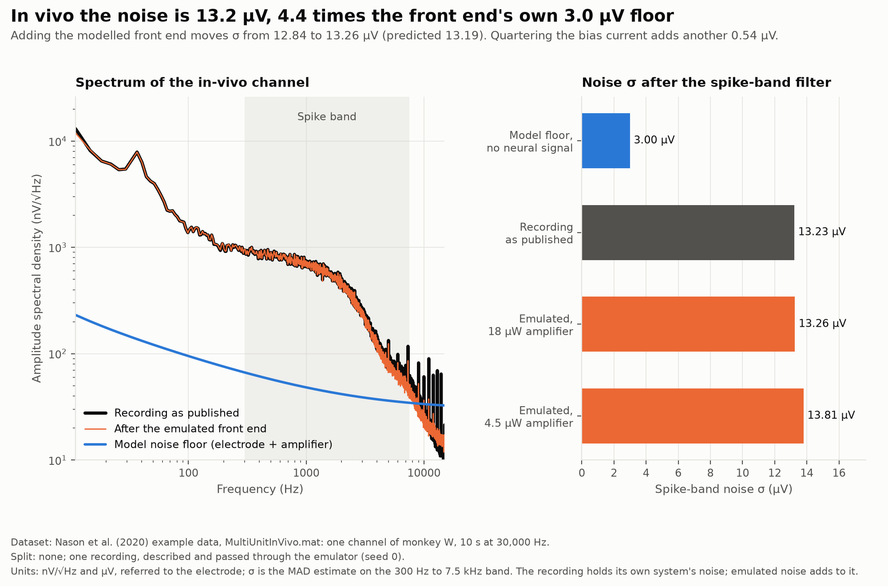

# NeuroChain

**What is the lowest-power neural sensing chain, in µW per channel, that still
decodes well while the implant is stimulating and its electrodes are aging?**

A brain implant has microvolt signals, a few milliwatts of power and a radio
that can send well under 1 % of what its electrodes record. Every stage of the
chain (electrode, amplifier, ADC, feature extraction, decoder) trades power
against decoding accuracy. NeuroChain models the whole chain, measures that
trade on public recordings, and implements the winning feature path in RTL.

The project has three parts:

- **A, co-design (the spine).** Front end, ADC, features and decoder under one
  power model, giving an accuracy-versus-µW Pareto surface.
- **B, recording while stimulating.** Stimulation artifact propagation,
  front-end saturation and recovery, and fixed-point adaptive cancellation.
- **C, aging stress test.** Simulated electrode aging on held-out sessions.

## Status

| Unit | What it delivers | State |
|---|---|---|
| U0 | Repo, data loaders, band-split, spectra and spike amplitudes | **Done** |
| U1 | Electrode and front-end model (ngspice), noise budget, NEF | **Done** |
| U2 | ADC sweeps; threshold, NEO and spiking-band-power features; fixed point | Next |
| U3 | Power model and co-design: accuracy vs µW Pareto | Planned |
| U4 | Kalman and GRU decoders, session-held-out evaluation | Planned |
| U5 | Stimulation artifacts and fixed-point cancellation | Planned |
| U6 | Electrode aging stress test | Planned |
| U7 | RTL (SystemVerilog), bit-exact tests, ECP5 synthesis | Planned |
| U8 | ADS1299 board, saline phantom, stimulator: design for later build | Planned |

Done-criteria for each unit are in [TODO.md](TODO.md).

## Results so far

### U0: what real implant recordings look like

Dataset: Neuralink Compression Challenge, 743 five-second clips from an N1
implant in non-human primate motor cortex. There is no train/test split because
nothing is fitted; these are descriptive statistics over every clean clip.
Amplitudes are in ADC LSB because Neuralink does not publish the gain.

<!-- BEGIN U0_RESULTS -->
| Quantity | Value | How it is defined |
|---|---|---|
| Clips analysed | 737 of 743 | 6 excluded: more than 0.1% of samples on an ADC rail |
| Recording time analysed | 3,727 s | 19,531 Hz |
| Spike-band noise σ | 7.01 (IQR 6.07 to 8.00) LSB | MAD estimate per clip, 300 Hz to 7.5 kHz |
| Noise σ ÷ ideal quantisation noise | 24.3× | quantisation noise of a 1 LSB step is 1/√12 LSB rms |
| Share of power below 300 Hz | 83.3% (IQR 74.2% to 90.2%) | LFP band power ÷ (LFP + spike band power), from 1 Hz |
| PSD slope | f^-1.36 and f^-1.27 | 10 to 300 Hz, and 300 Hz to 5 kHz; median spectrum |
| Spikes detected at −4.5σ | 28,575 | 7.67 /s pooled; median clip 0.99 /s; 158 clips have none |
| Detections expected from Gaussian noise alone | 0.061 /s | false-alarm floor of the detector at this threshold |
| Median spike trough depth | 43.7 (IQR 36.4 to 55.8) LSB | = 5.55 σ; measured on the filtered spike band |
| Events whose larger phase is negative | 86.0% | two opposite-sign crossings within 1 ms count as one event |
<!-- END U0_RESULTS -->

This table is generated from [results/u0_metrics.json](results/u0_metrics.json)
by `make readme`; a test recomputes those metrics from the raw clips.

Three findings shape the next units:

1. **Five sixths of the power is below 300 Hz.** A spike-only chain can remove
   it before the ADC and spend the ADC's range on spikes (the U1 coupling
   decision).
2. **The ADC's step is one seventh of the noise.** Discarding 3 of its 10 bits
   raises the noise σ by 4 % and loses 6.5 % of threshold crossings. Discarding
   5 breaks the detector (ten times the detections). U2 measures this properly
   against ground truth.
3. **Offline numbers flatter the implant.** Replacing the zero-phase analysis
   filter with a causal filter of the same order, which is what hardware can
   run, loses 60 % of threshold crossings, because phase distortion makes spike
   troughs shallower and most spikes sit just above the threshold.

Findings 2 and 3 come from `make u0-key ARGS="..."`; the exact commands are in
[docs/U0_design.md](docs/U0_design.md#5-prediction-checks).



*Top: one example clip, raw and split into the two bands. Bottom: median
amplitude spectral density across 737 clips with the interquartile range. Units:
ADC LSB and LSB/√Hz.*



*Top: threshold crossings on the example clip's spike band. Bottom: aligned
waveforms, and the trough depth of all 28,575 detected spikes in LSB and in
multiples of each clip's noise σ. The example clip is the clearest one by a
fixed rule, not a typical one.*

**Limits of these numbers.** There is no ground truth, so a "spike" is a
threshold crossing. The amplitude distribution is truncated at the threshold.
The analog chain before the ADC is unknown. More in
[docs/U0_design.md](docs/U0_design.md#limitations).

### U1: what the front end adds, and what it costs

A circuit model, not a dataset: a platinum Utah electrode (measured Randles
fit) into a capacitive-feedback amplifier, solved three ways. This is the first
unit in real microvolts.

<!-- BEGIN U1_RESULTS -->
| Quantity | Value | How it is defined |
|---|---|---|
| Electrode impedance at 1 kHz | 218 kΩ at −65° | platinum Utah electrode in saline (Straka et al., 2018); ngspice impedance within 0.07% of the analytic model |
| Front-end noise: hand / analytic / ngspice | 3.399 / 3.405 / 3.399 µV rms | referred to the tissue, 300 Hz to 7.5 kHz, at 37 °C |
| Largest disagreement between methods | 0.27% | across three electrode models; the done-criterion is 10 % |
| Electrode / amplifier share | 2.51 / 2.31 µV rms | analytic model; the two add in quadrature |
| Same electrode with an ideal-capacitor double layer | 0.95 µV electrode, 2.49 µV total | the textbook Randles circuit, matched to the same impedance magnitude at 1 kHz |
| Amplifier | gain 95.6, 0.98 Hz to 7.14 kHz | 10 µA at 1.8 V = 18 µW; NEF 4.00 |
| Electrode offset tolerated | AC: blocked; DC at the same gain: 8.4 mV | surviving 300 mV DC-coupled needs gain 2.5 and 17.5 ADC bits, against 12.3 |
| Time on the rail after a 50 mV offset step | 0.29 s at 1 Hz; 2.90 s at 0.1 Hz | emulated; the formula gives 0.291 s and 2.898 s |
| Emulator noise against the model | 295.1 against 295.4 µV rms | at the amplifier output, 300 Hz to 7.5 kHz, 60 s of emulated silence |
| Noise σ of a real in-vivo channel | 13.23 µV | 4.4 times the model's 3.00 µV through the same filter (Nason et al., one channel, 10 s) |
| That channel after the emulated front end | 13.26 µV (predicted 13.19) | up from 12.84 µV with the emulator's noise off |
| The same at a quarter of the bias current | 13.81 µV | amplifier power 4.5 µW instead of 18 µW |
<!-- END U1_RESULTS -->

This table is generated from [results/u1_metrics.json](results/u1_metrics.json)
by `make readme`. The ngspice netlists are in [spice/](spice/).

Three findings:

1. **The textbook electrode model understates noise by a factor of 2.6.** A real
   double layer is lossy (a constant-phase element), and only the lossy part of
   an impedance makes thermal noise. With an ideal capacitor matched to the same
   impedance at 1 kHz, electrode noise would look like 0.95 µV instead of
   2.51 µV.
2. **The amplifier is quieter than the brain needs.** A real in-vivo channel is
   over four times noisier than the front end's own floor, because neural
   background dominates. Cutting the amplifier's bias current to a quarter
   raises that channel's noise by 4 %. This is the trade U3 turns into a Pareto
   curve.
3. **Halving the bias current does not, by itself, raise an amplifier's total
   noise.** The noise density goes up by √2 and the bandwidth halves, so the
   two cancel; the NEF does not move either. The cost only appears when the
   bandwidth is held fixed.

Findings 2 and 3 can be re-run with `make u1-key ARGS="..."`; see the
[prediction checks](docs/U1_design.md#6-prediction-checks).



*Electrode impedance: the measured fit in saline, the ideal-capacitor version
with the same |Z| at 1 kHz, and the fit after implantation. Lines: analytic
model. Markers: ngspice.*



*Left: noise density referred to the tissue signal, by source, with ngspice
points. Right: spike-band noise by electrode model. Units: nV/√Hz and µV rms.*



*Left: output DC level against electrode offset for three coupling choices.
Right: emulated recovery after a 50 mV offset step at two high-pass corners.*



*Dataset: Nason et al. (2020), one channel of monkey W, 10 s at 30 kHz, no
split. The emulated front end barely changes a real channel's noise, at 18 µW
or at 4.5 µW.*

**Limits of these numbers.** The amplifier model has no 1/f noise, rails are a
hard clip, and the emulator adds noise to a recording that already has its own.
More in [docs/U1_design.md](docs/U1_design.md#limitations).

## Reproduce

Requires [uv](https://docs.astral.sh/uv/) and `make`. Python 3.12 is installed
by uv.

```
make setup     # environment and git hooks
make u0        # download data (65 MB), write the U0 figures, metrics and table
make u1        # U1 figures, metrics, table and netlists (needs ngspice and the Nason data)
make test      # 190+ tests; the ones needing data or ngspice skip if absent
```

U1 needs [ngspice](https://ngspice.sourceforge.io/) (`brew install ngspice`) and
the Nason files, which have to be downloaded in a browser (see Data).

`make help` lists every target.

## Data

Data is never committed. `make data` downloads what can be scripted and
verifies every file by SHA-256.

| Dataset | Used in | How it arrives |
|---|---|---|
| [Neuralink Compression Challenge](https://web.archive.org/web/20250901131704/https://content.neuralink.com/compression-challenge/README.html) | U0, U2, U5, U7 | Scripted. Neuralink removed the originals, so the Internet Archive copy is used and its hash pinned |
| [Nason et al. spiking-band-power data](https://doi.org/10.7302/wwya-5q86) | U2, U4 | Browser download (the host blocks scripts), then `make data` verifies it |
| [NoMAD](https://doi.org/10.5061/dryad.q83bk3jtp) | U4, U6 | Browser download, or scripted with a free Dryad API token in `DRYAD_TOKEN` |
| MEArec synthetic recordings | U2 | Generated locally |

## Layout

```
src/neurochain/
  recording.py          the container every loader returns
  data/                 registry, verified downloader, loaders, synthetic generator
  dsp/                  band-split filters, spectra, spike detection
  frontend/             electrode, amplifier, ngspice runner, emulator
  analysis/             per-unit analyses and their figures
  viz.py                shared figure style
scripts/                one script per figure or key number
tests/                  pytest; no test needs downloaded data unless marked `data`
docs/                   one design note per unit, plus references
spice/                  reference ngspice netlists (generated; kept in sync by a test)
figures/  results/      committed outputs, regenerated by make
```

## Learning notes

Each unit has a design note explaining the engineering reasoning, the
alternatives considered and the course concepts involved, plus prediction
checks: change one parameter, predict the result, then run it.

- [U0: repo, data and band-split](docs/U0_design.md)
- [U1: electrode and front-end model](docs/U1_design.md)
- [References](docs/references.md)

## Safety

The hardware phase uses saline only, never a person. Any on-body recording
would use a battery or isolated USB.
